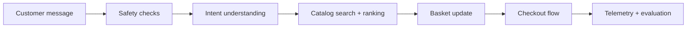

<div align="center">

# Shopi

### Colorful AI grocery shopping assistant

<a href="#quick-start">
  
</a>

<div>
  <a href="#quick-start">Try it now</a>
  ·
  <a href="#features">Features</a>
  ·
  <a href="#architecture">Architecture</a>
</div>

</div>

Shopi helps shoppers discover fresh groceries, compare options, and check out without friction. The experience is colorful, conversational, and designed for demos, rapid prototyping, and future AI-powered upgrades.

> Shopi is a demo storefront: it keeps a live basket, handles basket updates in conversation, and includes a Stripe-ready checkout flow with a secure demo fallback for local development.

---

## Quick start

```bash
npm install
npm run dev
```

Then open the app in your browser and try one of these prompts:

- "Show vegan snacks under $5"
- "Add two avocados"
- "What is in my basket?"
- "Checkout"

---

## Features

- Conversational shopping: search by keyword, category, dietary tag, or price.
- Smart basket management: add, remove, clear, and review totals in a single flow.
- Stripe-ready checkout: the basket can redirect to a hosted Stripe checkout session when a backend endpoint is configured, while the local demo still works without a live provider.
- Safety guardrails: personal data and prompt-injection attempts are blocked before the agent acts.
- Observability: latency, safety flags, and intents are logged for evaluation.

---

## Architecture



The project has a clear split between the pure agent core and browser-facing app code:

- `src/agent/` - turn handling, basket logic, safety rules, and dialogue flows
- `src/components/` - chat, product cards, and payment/checkout UI
- `src/services/` - Supabase integration and session wiring
- `src/lib/` - money formatting and persistence helpers

---

## Product catalog

The default catalog is seeded in Supabase and includes a wider mix of produce, dairy, pantry staples, drinks, frozen foods, and snacks. This keeps the demo colorful and realistic for more product discovery scenarios.

---

## Running tests

```bash
npm test
npm run build
```

---

## Roadmap

- [ ] Add sign-in and per-user baskets
- [x] Connect a Stripe-ready checkout flow with a live backend hook for production usage
- [x] Expand the catalog with seasonal offers and bundles
- [ ] Add review, ratings, and personalization signals
- [ ] Create a production-grade deployment flow

---

## Project notes

- The app is designed for demos and experimentation, but it includes a Stripe-ready payment path for real checkout deployments.
- The checkout flow falls back to a local demo payment when no production endpoint is configured so the app remains usable during development.
- The project metadata is published as a GitHub project so the storefront can be shared and iterated in public.
