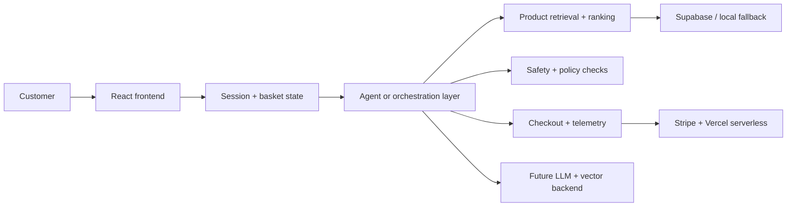

<div align="center">


# Shopi

### AI-powered grocery shopping with a real product and platform story

<p>
  <strong>Conversational commerce, retrieval-driven product discovery, durable session state, and a roadmap toward production-grade AI shopping.</strong>
</p>

<div>
  <a href="#platform-story">Platform story</a>
  ·
  <a href="#what-is-in-the-project">What’s in the project</a>
  ·
  <a href="#run-it-locally">Run locally</a>
  ·
  <a href="#deployment">Deployment</a>
  ·
  <a href="#roadmap">Roadmap</a>
</div>

<br />


</div>

Shopi is a conversational commerce platform for grocery shopping, designed to feel like a premium app while showcasing the engineering behind a production AI system. It combines a customer-friendly storefront, stateful shopping conversations, retrieval and ranking concepts, and deployment patterns that make sense for real-world product teams.

> This project is not just a toy chatbot. It is a readable, portfolio-friendly foundation for a serious AI shopping product with a clear migration path toward real model orchestration, vector retrieval, durable storage, monitoring, and customer-grade safety.

---

## Platform story

Shopi is designed around the real problems a customer-facing AI shopping system has to solve:

- understanding intent across multi-turn shopping conversations
- keeping basket state stable even as the user asks for modifications
- ranking products by preference, nutrition, and purchase fit
- handling contextual follow-up without losing memory
- making the experience safe, measurable, and easy to extend
- staying deployable in a modern frontend + backend architecture

This is the kind of story a strong AI product engineering portfolio should tell: product thinking first, architecture second, and operational clarity everywhere.

---

## Why this project feels production-ready

<div align="center">

<a href="#feature-grid"></a>
<a href="#feature-grid"></a>
<a href="#feature-grid"></a>
<a href="#feature-grid"></a>

</div>

### Core product experience
- multi-turn grocery assistance with intent-aware responses
- basket updates, quantity adjustments, and checkout flow cues
- personalized UX based on user profile and preference memory
- graceful fallback behavior when external services are unavailable

### AI and platform patterns
- orchestration logic for safety, retrieval, and product decisions
- front-end and backend separation for future model integration
- telemetry and event hooks for observability and quality tracking
- modular store and retrieval layers for future Qdrant, pgvector, or Postgres upgrades
- backend scaffolding for durable session storage and customer product flows

### Engineering quality
- Vercel-safe frontend build configuration
- TypeScript + React storefront with readable app structure
- Python backend skeleton for orchestration, persistence, and future LLM calls
- environment-driven config for local and hosted deployments
- architecture designed to be human-readable and easy to explain in interviews

---

## What is in the project

<div id="feature-grid">

### Product experience
- conversational grocery assistant UI
- live shopping basket and subtotal logic
- search and recommendation flow for product discovery
- checkout-ready workflow for server-side payment execution

### AI system architecture
- intention detection and multi-turn shopping logic
- guardrail-minded orchestration for safer flows
- retrieval and ranking abstractions for future production upgrades
- state awareness for cart, profile, and session memory

### Persistence and ops
- Supabase-ready schema and integration layer
- local fallback mode to keep the app working without third-party services
- Vercel serverless Stripe checkout route
- Docker-based local platform scaffolding and Azure deployment examples

### Production story
- deployment config for Vercel and Azure-style app hosting
- metrics, monitoring, and evaluation hooks
- quality checks for build and backend correctness
- a foundation for real LLM, Postgres, and vector workflows

</div>

---

## Platform architecture



This architecture is intentionally modular. It shows how a demo-first shopping assistant can evolve into a serious AI commerce product without rewriting the user experience from scratch.

---

## Try the interaction patterns

These are the kinds of prompts the app is designed to handle in a real shopping flow:

- “Show me vegan snacks under $5”
- “Add two avocados to my basket”
- “What is in my basket?”
- “Find dairy-free breakfast ideas”
- “Remove the bread from my cart”
- “I want a lighter lunch option”
- “Check out”

If the app is running locally, these prompts are a great sanity check for basket continuity, relevance filtering, and conversation state handling.

---

## Run it locally

### 1) Frontend

```bash
npm install
npm run dev
```

Then open the app in the browser and start shopping.

### 2) Production-safe deployment

This repo is set up for Vercel-style deployment and includes a serverless Stripe checkout route.

```bash
npm install
npm run build
```

Set the following environment variables in the deployment dashboard:

```bash
VITE_SUPABASE_URL=your_supabase_url
VITE_SUPABASE_ANON_KEY=your_supabase_anon_key
VITE_STRIPE_PUBLISHABLE_KEY=your_public_key
VITE_STRIPE_CHECKOUT_URL=/api/create-checkout-session
STRIPE_SECRET_KEY=your_secret_key
SITE_URL=https://shopi-assistant.vercel.app
```

### 3) Backend scaffold

```bash
cd backend
python -m venv .venv
source .venv/bin/activate
pip install -r requirements.txt
uvicorn app:app --reload --port 8000
```

The backend layer is intentionally structured for future real LLM orchestration, retrieval, vector search, durable sessions, and monitoring workflows.

---

## Deployment and platform story

This project already includes the building blocks for a credible AI product story:

- Vercel-hosted frontend delivery
- serverless Stripe checkout
- Supabase-ready persistence layer
- backend orchestration scaffold
- durable storage abstractions
- retrieval and ranking design
- telemetry and evaluation hooks
- Azure deployment examples and platform documentation

That makes the repo better than a simple demo: it reads like a real platform design narrative that can be explained to a hiring manager, product lead, or engineering team.

See [docs/production-deployment.md](docs/production-deployment.md) for the operational guide.

---

## Quality and validation

Use the same checks a team would run before shipping a customer-facing feature:

```bash
npm test
npm run build
python -m compileall backend
```

This validates the conversational logic, frontend build health, and backend scaffold without hiding complexity behind a vague “it works on my machine” story.

---

## Roadmap

### Already in place
- [x] conversational grocery shopping agent
- [x] cart and basket flow
- [x] Vercel-safe deployment setup
- [x] Stripe checkout integration path
- [x] Supabase-ready persistence schema
- [x] deployment and platform docs

### Next production upgrades
- [ ] live LLM orchestration with LangGraph or PydanticAI
- [ ] real vector retrieval with Qdrant or pgvector
- [ ] durable Postgres session storage
- [ ] production analytics and monitoring dashboard
- [ ] auth and per-user cart persistence
- [ ] advanced ranking and personalization
- [ ] production-grade evaluation and safety loops

---

## Why this project stands out

Shopi is a strong portfolio project because it does not pretend to be a finished production product while still showing a credible path to one. It communicates:

- product thinking and customer journey design
- AI system architecture and orchestration patterns
- retrieval, monitoring, and evaluation foundations
- real-world deployment awareness
- readable engineering that is easy to explain and extend

That combination makes it a strong example of applied AI engineering, product intuition, and platform-level thinking.

---

## Project structure

```bash
.
├── src/
│   ├── agent/
│   ├── components/
│   ├── hooks/
│   ├── lib/
│   └── services/
├── backend/
│   ├── app.py
│   ├── orchestrator.py
│   ├── retrieval.py
│   ├── storage.py
│   ├── monitoring.py
│   ├── evaluator.py
│   └── llm_agent.py
├── api/
│   └── create-checkout-session.js
├── supabase/
│   └── schema.sql
├── docs/
│   ├── architecture.md
│   ├── production-deployment.md
│   ├── shopi-demo.gif
│   └── shopi-hero.svg
├── .github/workflows/
│   └── deploy.yml
├── package.json
├── vercel.json
├── .env.example
├── README.md
└── docker-compose.yml
```

---

## Project note

This repo is intentionally readable and production-minded. It is built to communicate both product value and engineering depth, making it a strong fit for portfolio presentation, technical reviews, and AI product architecture conversations.
