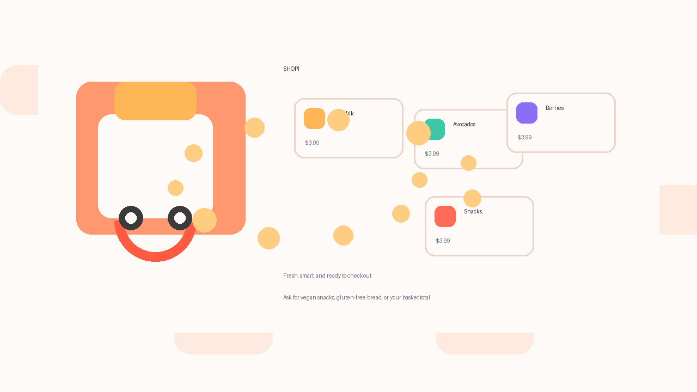
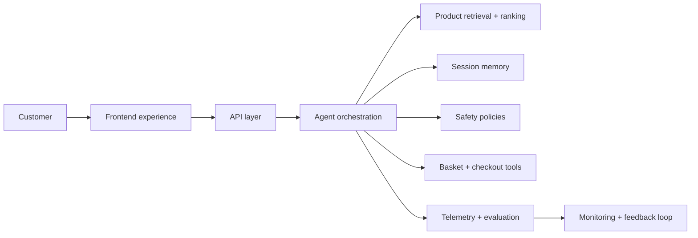

<div align="center">

# Shopi

### Production-aligned AI commerce platform for conversational grocery shopping

<a href="#quick-start">
  
</a>

<div>
  <a href="#architecture">Architecture</a>
  ·
  <a href="#running-the-platform">Running the platform</a>
  ·
  <a href="#roadmap">Roadmap</a>
</div>

</div>

Shopi is a production-minded conversational commerce platform that combines AI-driven shopping assistance, product retrieval, basket orchestration, and safety-aware customer interactions in one system. The current implementation is a foundational product-grade prototype designed to evolve into an end-to-end LLM platform with orchestration, state management, structured tool use, evaluation, and deployment controls.

> Shopi demonstrates how a customer-facing shopping assistant can move from isolated chat UX to a production architecture with guardrails, telemetry, retrieval, memory, and measurable operational quality.

---

## Why this project matters

Modern AI commerce experiences require more than a simple chatbot. They need:

- conversational understanding across multi-turn shopping journeys
- reliable state handling for basket, product context, and user intent
- retrieval and ranking over a live product catalog
- policy enforcement and safety checks before actions occur
- telemetry and evaluation systems to measure quality and regressions
- a path from prototype to production deployment with traceability and observability

Shopi embodies this pattern: a UI-driven shopping experience anchored by an agentic decision loop, explicit safety checks, and structured persistence for evaluation and iteration.

---

## Production architecture overview



The architecture follows a modular design that separates customer experience from orchestration, retrieval, and operational controls:

- `src/agent/` — intent understanding, basket logic, safety rules, and conversational state transitions
- `src/components/` — storefront UI, shopping chat, product cards, and checkout flows
- `src/services/` — turn execution, persistence, and telemetry pipelines
- `src/lib/` — catalog, money, and persistence helpers
- `supabase/` — data layer and retrieval integration

This creates the foundation for a larger LLM platform where the same patterns can expand into:

- model orchestration with tool calling
- vector or semantic retrieval for personalized recommendations
- conversation memory and long-lived session state
- automated evaluation and guardrail monitoring
- production deployment, observability, and experimentation loops

---

## End-to-end platform design

A full production version of Shopi would extend the current prototype into the following stack:

### 1. Customer-facing experience
- React storefront with chat, product discovery, basket, and checkout flows
- responsive shopping UX optimized for mobile and web
- session-based continuity and contextual re-entry

### 2. API and orchestration layer
- REST or GraphQL API for chat turns, cart actions, and product queries
- orchestration framework such as LangGraph or PydanticAI for structured reasoning and tool calls
- explicit task routing for search, add/remove, basket review, and secure checkout

### 3. Retrieval and ranking
- product retrieval over structured catalog metadata
- semantic search for intent expansion and recommendations
- ranking logic for relevance, price sensitivity, dietary preferences, and personalization

### 4. Memory and context management
- session state stored in durable storage
- conversation memory with user preferences and basket history
- context compression and summarization for long-running shopping sessions

### 5. Safety and guardrails
- prompt-injection detection
- PII and sensitive data filtering
- policy enforcement for off-topic and unsafe instructions
- explicit fallback paths when the system cannot complete a request safely

### 6. Evaluation and monitoring
- golden dataset for shopping intents and edge cases
- automated evaluations for tool correctness and user satisfaction
- telemetry for latency, error rates, safety flags, and user conversions
- dashboards and feedback loops to improve product quality after launch

### 7. Production operations
- model serving with hosted or self-hosted inference
- infrastructure automation, staging environments, and deploy policies
- logging, tracing, and rollback procedures for live customer traffic

See [docs/architecture.md](docs/architecture.md) for the full platform blueprint.

---

## Running the platform

### Production deployment

See [docs/production-deployment.md](docs/production-deployment.md) for the deployment checklist, environment variables, and container strategy.

### Frontend demo

```bash
npm install
npm run dev
```

Then open the app in your browser and try prompts such as:

- "Show vegan snacks under $5"
- "Add two avocados"
- "What is in my basket?"
- "Checkout"

### LLM-ready backend scaffold

```bash
cd backend
python -m venv .venv
. .venv\Scripts\activate
pip install -r requirements.txt
uvicorn app:app --reload --port 8000
```

Then point the frontend to the backend by setting:

```bash
VITE_SHOPI_API_URL=http://localhost:8000
```

This backend is intentionally designed to be easy to read and extend. It exposes a simple FastAPI API, determines shopping intent, applies safety checks, and demonstrates the orchestration layer that a larger LLM platform would later replace with a model-backed agent flow.

---

## Quality and validation

```bash
npm test
npm run build
python -m compileall backend
```

This helps validate the conversational logic, guardrails, and frontend build health as the platform evolves from prototype toward production readiness.

A GitHub Actions workflow is included in `.github/workflows/deploy.yml` to run validation on pushes and pull requests before deployment.

---

## Roadmap

- [ ] Add authenticated user sessions and persistent per-user carts
- [x] Connect a Stripe-ready checkout flow with a secure demo fallback
- [x] Expand the catalog with realistic grocery categories and dietary metadata
- [ ] Add semantic retrieval, recommendation ranking, and personalization signals
- [ ] Add a backend orchestration layer for production-grade LLM workflows
- [ ] Integrate evaluation pipelines, monitoring, and guardrail automation
- [ ] Deploy a staging and production environment with traceable observability

---

## Project notes

Shopi is intentionally designed as a high-signal product prototype: it demonstrates the user experience, agent logic, safety patterns, and evaluation mindset needed to move from demo to production-quality AI commerce systems. It is a strong foundation for teams building customer-facing LLM products where product design, safety, retrieval, and operational quality matter as much as model performance itself.
