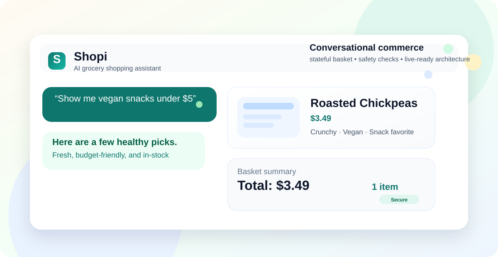
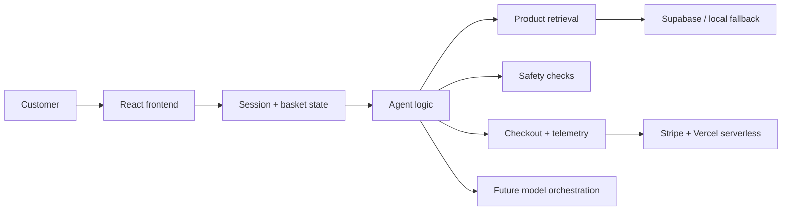

<div align="center">

# Shopi

### AI-powered grocery shopping, designed like a production conversational commerce system



<div>
  <a href="#why-shopi">Why Shopi</a>
  ·
  <a href="#what-is-in-the-project-right-now">What’s in the project</a>
  ·
  <a href="#run-it-locally">Run it locally</a>
  ·
  <a href="#deployment">Deployment</a>
  ·
  <a href="#roadmap">Roadmap</a>
</div>

</div>

Shopi is a full-stack conversational shopping app that blends a grocery storefront, AI decision-making, basket state management, safety-aware UX, and production-minded deployment patterns. It is not just a demo assistant — it is a platform-ready architecture for customer-facing commerce AI, built to look and feel like a real product while staying readable for human review.

> The experience is intentionally designed to be easy to understand, ship, and extend. That makes it a strong example of how a concept prototype can evolve into a practical LLM-driven product system.

---

## Why Shopi

Modern grocery shopping is no longer just about listing products. A thoughtful shopping assistant has to:

- understand the user’s intent across multiple turns
- manage basket state without losing context
- filter by dietary or budget preferences
- surface products with structured relevance
- protect the flow with safety checks and guardrails
- support a real checkout flow without exposing secrets
- behave well in both local demo and production deployment environments

Shopi brings all of that together in a product-like experience. It is built to illustrate how a conversational shopping assistant can evolve from “chatbot demo” into an operational AI commerce product.

---

## What makes it feel production-ready

### Core product experience
- multi-turn shopping conversations with intent-based responses
- smart product search and recommendation flow
- basket tracking with quantity updates and totals
- checkout ready for a server-side payment flow
- graceful fallback mode when external services are not configured

### AI and platform patterns
- layered orchestration for search, safety, basket updates, and session state
- front-end + backend separation for future LLM integration
- telemetry hooks for understanding interaction quality and latency
- retrieval and ranking abstraction for semantic or vector-based upgrades
- durable session/storage abstractions for real backend persistence

### Engineering quality
- Vercel-ready build setup
- TypeScript + Vite frontend
- Python FastAPI backend scaffold for orchestration and future model integration
- environment-based configuration for local and hosted deployments
- readable code structure designed for human review and product storytelling

---

## What is in the project right now

### Frontend
- React + TypeScript storefront experience
- shopping chat panel and basket panel
- cart state updates and total calculations
- downloadable CSV export for observability and demo data inspection

### AI agent layer
- intent understanding for shopping requests
- basket actions, product selection, follow-up questions, and safety checks
- contextual state for last result sets and pending choices

### Persistence and services
- Supabase-ready integration for products, baskets, and event logs
- optional runtime fallback so the app still works without external keys
- Vercel serverless Stripe checkout endpoint
- backend scaffolding for future LLM orchestration and retrieval services

### Deployment and ops
- Vercel deployment config
- Azure deployment workflow examples for managed backend deployment
- Docker compose and backend runtime config for local platform experimentation
- docs for production architecture and deployment guidance

---

## Try the interaction patterns

These are the kinds of shopping moments the app is designed to handle:

- “Show me vegan snacks under $5”
- “Add two avocados to my basket”
- “What is in my basket?”
- “Find dairy-free options for lunch”
- “I want something for breakfast”
- “Remove the bread from my cart”
- “Check out”

If the app is running locally, these prompts are a good quick sanity check for stateful basket behavior and product search quality.

---

## Architecture snapshot



The system is intentionally modular so that a future LLM backend can slot into the same behavior without rewriting the customer experience.

---

## Project structure

```bash
.
├── src/
│   ├── agent/
│   ├── components/
│   ├── hooks/
│   ├── lib/
│   └── services/
├── backend/
│   ├── app.py
│   ├── orchestrator.py
│   ├── retrieval.py
│   ├── storage.py
│   ├── monitoring.py
│   ├── evaluator.py
│   └── llm_agent.py
├── api/
│   └── create-checkout-session.js
├── supabase/
│   └── schema.sql
├── docs/
│   ├── architecture.md
│   ├── production-deployment.md
│   └── shopi-hero.svg
├── .github/workflows/
│   └── deploy.yml
├── package.json
├── vercel.json
├── .env.example
├── README.md
└── docker-compose.yml
```

---

## Run it locally

### 1) Frontend

```bash
npm install
npm run dev
```

Then open the app in the browser and start shopping.

### 2) Production-safe Vercel deployment

This repo includes a Vercel deployment configuration and a serverless Stripe checkout route.

```bash
npm install
npm run build
```

Deploy to Vercel with the repo root as the project root. Make sure the environment variables are set in the Vercel dashboard:

```bash
VITE_SUPABASE_URL=your_supabase_url
VITE_SUPABASE_ANON_KEY=your_supabase_anon_key
VITE_STRIPE_PUBLISHABLE_KEY=your_public_key
VITE_STRIPE_CHECKOUT_URL=/api/create-checkout-session
STRIPE_SECRET_KEY=your_secret_key
SITE_URL=https://shopi-assistant.vercel.app
```

### 3) Backend scaffold

```bash
cd backend
python -m venv .venv
source .venv/bin/activate
pip install -r requirements.txt
uvicorn app:app --reload --port 8000
```

The backend layer is designed for future real LLM orchestration, durable memory, retrieval, and telemetry, while still working in a readable, understandable way.

---

## Production deployment and platform story

This project already includes the building blocks for a serious platform story:

- Vercel-hosted frontend
- serverless Stripe checkout
- Supabase-ready persistence layer
- backend orchestration scaffold
- storage and retrieval abstraction
- evaluation and telemetry hooks
- deployment docs and CI workflow

That means the project is not just a toy app — it is structured as a realistic foundation for a production AI commerce platform.

See [docs/production-deployment.md](docs/production-deployment.md) for the full operational guide.

---

## Quality and validation

Use the same checks a real product team would run before shipping:

```bash
npm test
npm run build
python -m compileall backend
```

This validates the conversational logic, build health, and backend scaffolding while keeping the architecture transparent and maintainable.

---

## Roadmap

### Already in place
- [x] conversational shopping agent
- [x] product search and basket flow
- [x] Vercel-safe deployment setup
- [x] Stripe-ready serverless checkout
- [x] Supabase schema and persistence route
- [x] deployment docs and architecture notes

### Next production upgrades
- [ ] live LLM orchestration with LangGraph or PydanticAI
- [ ] real vector retrieval with Qdrant or pgvector
- [ ] durable Postgres session storage
- [ ] production analytics and monitoring dashboard
- [ ] auth and per-user cart persistence
- [ ] advanced ranking and personalization
- [ ] production-grade evaluation and safety loops

---

## Why this project stands out

Shopi is a strong example of a product-centered AI system because it is not hiding complexity. It shows the trade-offs, modular boundaries, and growth path that a real customer-facing AI product needs.

It reflects the kind of engineering story teams actually care about:

- from prototype to platform thinking
- from chat UX to product architecture
- from demo features to operational readiness
- from isolated AI logic to a fuller product system

That is what makes the project compelling for portfolio, product storytelling, and technical discussions.

---

## Project note

This repo is intentionally readable and production-minded. It is built to communicate both product value and engineering depth, which makes it a good fit for portfolio presentation, technical reviews, and AI product architecture conversations.
