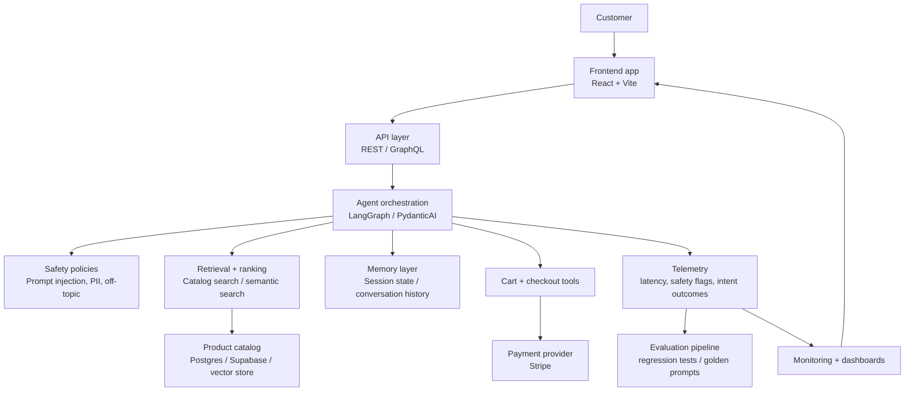

# Shopi platform architecture

## 1. Objective

Shopi is designed to demonstrate a production-minded AI commerce workflow: the user describes a shopping need in natural language, the system reasons about intent, retrieves the best catalog matches, preserves shopping state across turns, and safely completes the task with a checkout flow.

The current codebase is a strong prototype foundation. The next step is to evolve it into an end-to-end LLM platform built on a clear separation between UX, orchestration, retrieval, memory, evaluation, and operations.

## 2. End-to-end system layout

## 3. Core components

### Frontend layer
- React-based storefront experience for shopping and checkout
- chat interface for natural language requests
- product cards, basket state, and payment UX
- responsive design optimized for fast product discovery

### API layer
- handles session-scoped chat requests
- validates user inputs and payload contracts
- exposes cart, search, and checkout actions for the frontend
- acts as the boundary between UI and orchestration

### Agent orchestration layer
- interprets user requests into structured intents
- invokes tools for product lookup, basket update, and checkout actions
- manages multi-turn conversation boundaries and context
- composes tool results into clear user-facing responses

### Retrieval and ranking layer
- searches product metadata using category, dietary tags, name, and price filters
- enhances discovery with semantic search and personalized ranking
- balances relevance, transaction intent, and product constraints

### Memory layer
- stores session history and basket state across turns
- tracks user preferences and recurring shopping behavior
- supports long-running sessions with summarization or context compaction

### Safety and policy layer
- blocks unsafe prompts before they trigger actions
- filters sensitive user content and private data attempts
- enforces product-domain boundaries and fallback behaviors
- emits structured safety metadata to telemetry and evaluation systems

### Telemetry and evaluation layer
- records request latency, tool usage, and intent outcomes
- captures guardrail triggers and user-facing response quality
- tests against golden examples covering search, add/remove, basket review, and edge cases
- supports continuous improvement with production dashboards and regressions

## 4. Production-grade data flow

1. User submits a message from the storefront.
2. Frontend calls the API with session context and basket state.
3. API routes the request to the orchestrator and preserves a conversation trace.
4. Orchestrator resolves the intent and invokes the appropriate tools.
5. Retrieval layer searches the product catalog and returns ranked candidates.
6. Safety layer validates the request before action is taken.
7. Basket service updates the current cart or checkout action with atomic state changes.
8. Telemetry captures user intent, safety flags, latency, and task completion.
9. Monitoring and evaluation loops review the outcome and improve future system behavior.

## 5. Technology choices for a production implementation

### Recommended stack
- Frontend: React + TypeScript + Vite
- API: FastAPI or Node/Express
- Agent orchestration: LangGraph or PydanticAI
- Model serving: OpenAI-compatible or self-hosted model with vLLM / TGI
- Vector retrieval: Qdrant or pgvector
- Storage: PostgreSQL or Supabase for catalog/session state
- Monitoring: OpenTelemetry, structured logs, metrics dashboards
- Evaluation: DeepEval, custom golden datasets, regression harnesses

### Why this stack
This stack aligns with the project’s current strengths while enabling the missing production capabilities:
- orchestration over multi-step reasoning
- retrieval over real product knowledge
- safer customer-facing agent loops
- production telemetry and experimentation

## 6. Roadmap toward production readiness

### Phase 1: Prototype hardening
- stable session flow
- stricter input validation
- production-safe config and deployment setup

### Phase 2: Backend orchestration
- API service and tool abstraction
- LLM orchestration with explicit step boundaries
- product search and basket actions as tools

### Phase 3: Retrieval and personalization
- semantic search over the catalog
- ranking model or business rules for freshness, relevance, and user affinity
- preference memory and product recommendations

### Phase 4: Evaluation and reliability
- golden prompts and regression suites
- safety evals and policy checks
- model/route performance dashboards

### Phase 5: Live deployment
- staging and production separation
- observability and alerting
- rollback and incident playbooks

## 7. Conclusion

Shopi is already a strong prototype for an AI-commerce assistant. The architecture above shows how it can expand from a storefront demo into a full LLM platform with orchestration, retrieval, memory, evaluation, and operational rigour. The core idea remains simple: use AI to assist with shopping tasks while guaranteeing safety, continuity, and measurable product quality.
